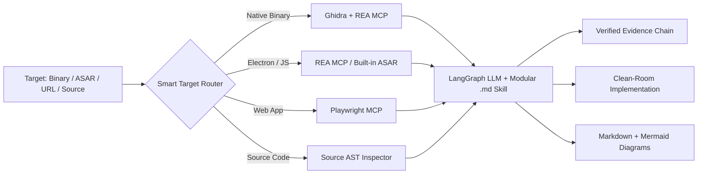

<div align="center">

# ⚡ DecompFlow

**Autonomes KI-Studio für Reverse Engineering, Dekompilierung & Architektur-Rekonstruktion**  
*LangGraph • Model Context Protocol (MCP) • REA • Ghidra • Playwright*

[](../../LICENSE)
[](#schnellstart)
[](#architektur)
[](#)

</div>

<p align="center">
  [English](../../README.md) •
  [Русский](README.ru.md) •
  [Українська](README.uk.md) •
  [हिन्दी](README.hi.md) •
  [简体中文](README.zh-CN.md) •
  [Español](README.es.md) •
  [Deutsch](README.de.md) •
  [Português](README.pt-BR.md) •
  [日本語](README.ja.md)
</p>

---


## 📖 Projektübersicht

DecompFlow ist eine plattformübergreifende Umgebung für die automatisierte Softwareanalyse, die LangGraph-Zustandsmaschinen mit dem Model Context Protocol (MCP) verbindet und Ghidra, REA sowie Playwright vereint.

### ✨ Hauptfunktionen

- **Automatische Zielerkennung (`detectTargetType`):**
  - 🧬 **Native Binärdateien (`.exe`, `.elf`, `.dll`, `.so`, `.dylib`, `.apk`):** Dekompilierung, Querverweis-Analyse (xrefs), String-Extraktion und Kontrollflussrekonstruktion mit Ghidra MCP und REA.
  - 📦 **Electron- & JS-Bundles (`.asar`, minifizierter Code):** Auslesen von IPC-Kanälen (`ipcMain` / `ipcRenderer`), Preload-Bridges und Modulgrenzen via REA MCP.
  - 🌐 **Webanwendungen (`http://`, `https://`):** Analyse von DOM-Bäumen, Client-Skripten und verborgenen REST/WebSocket-Endpunkten mit Playwright MCP.
  - 📂 **Quellcode-Repositories:** Erstellung von Abhängigkeitsgraphen, Sicherheitsaudits und Onboarding-Dokumentationen.
- **Verifizierte Nachweiskette & Clean-Room-Rekonstruktion:** Jeder Befund enthält prüfbare Belege (Speicheradresse, Pfad, IPC-Kanal) und erzeugt sauberen TypeScript/Python-Code.
- **Duale Oberfläche (CLI + Desktop Studio):** Headless-CLI für Terminals/CI oder visuelle Desktop-GUI mit interaktiven React Flow-Knoten und Mermaid-Diagrammen.
- **Native Betriebssystem-Integration (Linux, Windows, macOS):** Übernahme von Systemfarben, Proxy-Konfigurationen, nativen Dateipfaden (`XDG` / `AppData` / `Application Support`) und Tastenkombinationen.

---

## 🏗️ Architektur



---

## 🚀 Schnellstart

```bash
# Клонирование и компиляция
git clone https://github.com/dropt1mx0/DecompFlow.git
cd DecompFlow
npm install
npm run build

# Запуск графического интерфейса Studio
npm run desktop

# Вызов анализа через терминал (CLI)
npm run dev -- analyze ./samples/sample_bin --mode binary --skill feature-reconstruct --prompt "buffer processing"
```

---

## 🧠 Modulare Fähigkeiten (skills/*.md)

| Fähigkeit (Skill) | Beschreibung |
|---|---|
| **feature-reconstruct.md** | Sucht gezielte Features, erstellt Nachweistabellen und generiert saubere Clean-Room-Implementierungen. |
| **binary-architecture.md** | Rekonstruiert Module, Einstiegspunkte und Mermaid-Aufrufdiagramme aus C-Code. |
| **security-audit.md** | Prüft Speichersicherheit, Festcodierte Schlüssel, unsichere IPC-Verbindungen und OWASP-Risiken. |
| **web-api-mapper.md** | Extrahiert REST/GraphQL/WebSocket-Schemas und Authentifizierungsabläufe aus Webzielen. |
| **repo-onboarding.md** | Erstellt Architekturübersichten und Datenflussdiagramme für unbekannte Codebasen. |
| **refactoring-doc.md** | Säubert dekompilierten Code und schlägt semantische Funktionsnamen vor. |

---

## 🖥️ Plattformübergreifende Pakete

```bash
# Linux (.AppImage, .deb, .rpm)
npm run dist:linux

# Windows (.exe NSIS & Portable)
npm run dist:win

# macOS (.dmg & .zip)
npm run dist:mac
```

---

## 📁 Monorepo-Struktur

```plaintext
DecompFlow/
├── config/                  # LLM settings (decompflow.yaml) & MCP registry (mcp-servers.json)
├── docs/i18n/               # Multilingual documentation
├── skills/                  # Modular Markdown skills for the AI agent
├── tools/                   # Local Ghidra JSON-RPC / MCP bridge
├── visual/                  # Exportable Dify DSL workflow template
└── packages/
    ├── core/                # @decompflow/core — LangGraph state machine & MCP client manager
    ├── cli/                 # decompflow — Terminal CLI interface
    └── desktop/             # @decompflow/desktop — Electron + React + Tailwind + React Flow Studio
```

---

## ⚖️ Haftungsausschluss (Disclaimer)

DecompFlow ist ausschließlich für autorisierte Sicherheitsaudits, Interoperabilitätsforschung, Software-Erhaltung und Ausbildungszwecke an Systemen mit ausdrücklicher Genehmigung vorgesehen. Jeder Missbrauch zur Lizenzverletzung oder zur Erstellung von Schadsoftware ist untersagt.

---

## 📄 Lizenz (MIT)

Dieses Projekt ist unter der quelloffenen MIT-Lizenz veröffentlicht. Weitere Einzelheiten finden sich in der Datei LICENSE im Hauptverzeichnis.
