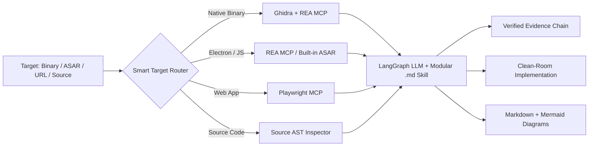

<div align="center">

# ⚡ DecompFlow

**Estudio Autónomo de Ingeniería Inversa con IA, Descompilación y Reconstrucción**  
*LangGraph • Model Context Protocol (MCP) • REA • Ghidra • Playwright*

[](../../LICENSE)
[](#inicio-rápido)
[](#arquitectura)
[](#)

</div>

<p align="center">
  [English](../../README.md) •
  [Русский](README.ru.md) •
  [Українська](README.uk.md) •
  [हिन्दी](README.hi.md) •
  [简体中文](README.zh-CN.md) •
  [Español](README.es.md) •
  [Deutsch](README.de.md) •
  [Português](README.pt-BR.md) •
  [日本語](README.ja.md)
</p>

---


## 📖 Visión General

DecompFlow es una plataforma de ingeniería inversa multiplataforma que combina la orquestación de LangGraph con el protocolo MCP (Model Context Protocol), integrando Ghidra, REA y Playwright para el análisis de software.

### ✨ Capacidades Clave

- **Autodetección inteligente del objetivo (`detectTargetType`):**
  - 🧬 **Binarios Nativos (`.exe`, `.elf`, `.dll`, `.so`, `.dylib`, `.apk`):** Descompilación de funciones, seguimiento de referencias cruzadas (xrefs) y reconstrucción del flujo de control con Ghidra MCP + REA.
  - 📦 **Paquetes Electron y JS (`.asar`, bundles minificados):** Extracción de canales IPC (`ipcMain` / `ipcRenderer`), puentes de precarga e interfaces de módulos vía REA MCP.
  - 🌐 **Aplicaciones Web (`http://`, `https://`):** Mapeo de estructuras DOM, scripts cliente y rutas REST/WebSocket ocultas mediante Playwright MCP.
  - 📂 **Repositorios de Código Fuente:** Generación de grafos de dependencias, auditoría de seguridad y documentación de incorporación.
- **Cadena de Evidencia Verificable y Reconstrucción en Sala Limpia:** Cada hallazgo cuenta con referencias verificables (dirección de memoria, archivo, canal IPC) y genera código limpio en TypeScript/Python.
- **Doble Interfaz (CLI + Desktop Studio):** Ejecución automatizada en terminal/CI o exploración visual en GUI de escritorio con nodos interactivos de React Flow.
- **Integración Nativa con el Sistema (Linux, Windows, macOS):** Adopción automática del tema del sistema, color de acento, proxy y rutas estándar (`XDG` / `AppData` / `Application Support`).

---

## 🏗️ Arquitectura



---

## 🚀 Inicio Rápido

```bash
# Клонирование и компиляция
git clone https://github.com/dropt1mx0/DecompFlow.git
cd DecompFlow
npm install
npm run build

# Запуск графического интерфейса Studio
npm run desktop

# Вызов анализа через терминал (CLI)
npm run dev -- analyze ./samples/sample_bin --mode binary --skill feature-reconstruct --prompt "buffer processing"
```

---

## 🧠 Habilidades Modulares (skills/*.md)

| Habilidad (Skill) | Descripción |
|---|---|
| **feature-reconstruct.md** | Rastrea una funcionalidad específica, construye la tabla de evidencias y genera una implementación limpia. |
| **binary-architecture.md** | Reconstruye módulos de alto nivel, puntos de entrada y diagramas Mermaid a partir de código C descompilado. |
| **security-audit.md** | Detecta fallos de seguridad en memoria, secretos hardcodeados, puentes IPC inseguros y riesgos OWASP. |
| **web-api-mapper.md** | Extrae esquemas REST/GraphQL/WebSocket y flujos de autenticación en entornos web. |
| **repo-onboarding.md** | Genera resúmenes arquitectónicos y diagramas de flujo para proyectos no familiares. |
| **refactoring-doc.md** | Limpia código descompilado o minificado y propone nombres semánticos para funciones sub_*. |

---

## 🖥️ Empaquetado Multiplataforma

```bash
# Linux (.AppImage, .deb, .rpm)
npm run dist:linux

# Windows (.exe NSIS & Portable)
npm run dist:win

# macOS (.dmg & .zip)
npm run dist:mac
```

---

## 📁 Estructura del Monorepo

```plaintext
DecompFlow/
├── config/                  # LLM settings (decompflow.yaml) & MCP registry (mcp-servers.json)
├── docs/i18n/               # Multilingual documentation
├── skills/                  # Modular Markdown skills for the AI agent
├── tools/                   # Local Ghidra JSON-RPC / MCP bridge
├── visual/                  # Exportable Dify DSL workflow template
└── packages/
    ├── core/                # @decompflow/core — LangGraph state machine & MCP client manager
    ├── cli/                 # decompflow — Terminal CLI interface
    └── desktop/             # @decompflow/desktop — Electron + React + Tailwind + React Flow Studio
```

---

## ⚖️ Aviso de Responsabilidad (Disclaimer)

DecompFlow está diseñado exclusivamente para auditorías de seguridad autorizadas, investigación de interoperabilidad, preservación de software heredado y educación en sistemas donde posea permisos legítimos de análisis. Queda prohibido su uso para eludir protecciones o generar software dañino.

---

## 📄 Licencia (MIT)

El proyecto se distribuye bajo la licencia de código abierto MIT. Para más detalles, consulte el archivo LICENSE en el repositorio.
