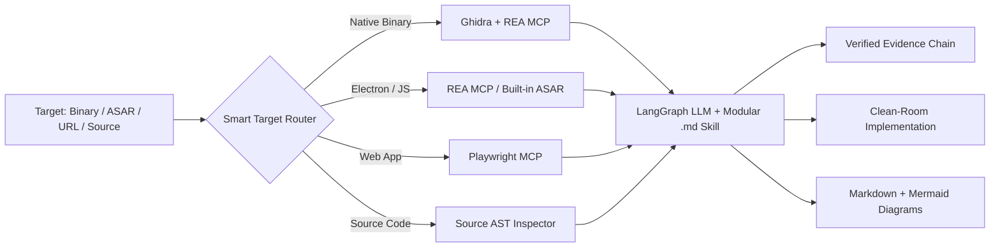

<div align="center">

# ⚡ DecompFlow

**स्वायत्त AI रिवर्स इंजीनियरिंग, बाइनरी डीकंपाइलेशन और आर्किटेक्चर पुनर्निर्माण स्टूडियो**  
*LangGraph • Model Context Protocol (MCP) • REA • Ghidra • Playwright*

[](../../LICENSE)
[](#त्वरित-शुरुआत)
[](#वास्तुकला-(architecture))
[](#)

</div>

<p align="center">
  [English](../../README.md) •
  [Русский](README.ru.md) •
  [Українська](README.uk.md) •
  [हिन्दी](README.hi.md) •
  [简体中文](README.zh-CN.md) •
  [Español](README.es.md) •
  [Deutsch](README.de.md) •
  [Português](README.pt-BR.md) •
  [日本語](README.ja.md)
</p>

---


## 📖 सिस्टम अवलोकन

DecompFlow एक क्रॉस-प्लेटफ़ॉर्म AI-आधारित स्टूडियो है जो LangGraph और MCP (Model Context Protocol) के माध्यम से सॉफ़्टवेयर विश्लेषण, बाइनरी रिवर्स इंजीनियरिंग और Electron/वेब ऐप्लिकेशन्स की जांच को सुगम बनाता है।

### ✨ प्रमुख क्षमताएं

- **मल्टी-टारगेट ऑटो-डिटेक्शन (`detectTargetType`):**
  - 🧬 **नेटिव बायनेरिज़ (`.exe`, `.elf`, `.dll`, `.so`, `.dylib`, `.apk`):** Ghidra MCP और REA के जरिए फ़ंक्शन डीकंपाइलेशन, क्रॉस-रेफ़्रेंस (xrefs) और कंट्रोल फ़्लो का विश्लेषण।
  - 📦 **Electron और JS बंडल (`.asar`, मिनिफ़ाइड फ़ाइलें):** REA MCP और अंतर्निहित ऑफ़लाइन टूल से IPC चैनल्स (`ipcMain` / `ipcRenderer`) और प्रीलोड ब्रिज की मैपिंग।
  - 🌐 **वेब ऐप्लिकेशन्स (`http://`, `https://`):** Playwright MCP द्वारा DOM संरचना, क्लाइंट स्क्रिप्ट्स और हिडन REST/WebSocket एंडपॉइंट्स का विश्लेषण।
  - 📂 **सोर्स कोड रिपॉजिटरीज़:** मॉड्यूलर आर्किटेक्चर आरेख, सुरक्षा ऑडिट और ऑनबोर्डिंग दस्तावेज़ तैयार करना।
- **सत्यापित साक्ष्य एवं क्लीन-रूम रिकंस्ट्रक्शन:** हर खोज एक सत्यापित साक्ष्य तालिका (मेमोरी पता, फ़ाइल, चैनल) के साथ आती है और साफ़ TypeScript/Python कोड उत्पन्न करती है।
- **दोहरा इंटरफ़ेस (CLI + Desktop Studio):** ऑटोमेशन के लिए हेडलेस टर्मिनल CLI या React Flow नोड्स व Mermaid आरेखों के साथ आधुनिक डेस्कटॉप GUI।
- **नेटिव ऑपरेटिंग सिस्टम इंटीग्रेशन:** सिस्टम थीम, एक्सेंट कलर्स, OS प्रॉक्सी और नेटिव स्टोरेज डायरेक्टरीज़ (`XDG` / `AppData` / `Application Support`) का स्वतः उपयोग।

---

## 🏗️ वास्तुकला (Architecture)



---

## 🚀 त्वरित शुरुआत

```bash
# Клонирование и компиляция
git clone https://github.com/dropt1mx0/DecompFlow.git
cd DecompFlow
npm install
npm run build

# Запуск графического интерфейса Studio
npm run desktop

# Вызов анализа через терминал (CLI)
npm run dev -- analyze ./samples/sample_bin --mode binary --skill feature-reconstruct --prompt "buffer processing"
```

---

## 🧠 मॉड्यूलर स्किल्स (skills/*.md)

| स्किल (Skill) | विवरण |
|---|---|
| **feature-reconstruct.md** | विशिष्ट फ़ंक्शन की पहचान, साक्ष्य तालिका का निर्माण और क्लीन-रूम कोड रिकंस्ट्रक्शन। |
| **binary-architecture.md** | डीकंपाइल्ड C कोड से उच्च-स्तरीय मॉड्यूल्स, एंट्री पॉइंट्स और कॉल ग्राफ़्स का निर्माण। |
| **security-audit.md** | मेमोरी सुरक्षा त्रुटियों, अनसेफ़ IPC ब्रिजेस और OWASP कमियों की पहचान। |
| **web-api-mapper.md** | वेब लक्ष्यों से REST, GraphQL, और WebSocket स्कीमा का निष्कर्षण। |
| **repo-onboarding.md** | अपरिचित कोडबेस के लिए त्वरित वास्तुकला अवलोकन और डेटा-प्रवाह आरेख। |
| **refactoring-doc.md** | डीकंपाइल्ड कोड की सफ़ाई और अज्ञात फ़ंक्शंस के लिए अर्थपूर्ण नामों का सुझाव। |

---

## 🖥️ क्रॉस-प्लेटफ़ॉर्म पैकेजिंग

```bash
# Linux (.AppImage, .deb, .rpm)
npm run dist:linux

# Windows (.exe NSIS & Portable)
npm run dist:win

# macOS (.dmg & .zip)
npm run dist:mac
```

---

## 📁 मोनोरिपो संरचना

```plaintext
DecompFlow/
├── config/                  # LLM settings (decompflow.yaml) & MCP registry (mcp-servers.json)
├── docs/i18n/               # Multilingual documentation
├── skills/                  # Modular Markdown skills for the AI agent
├── tools/                   # Local Ghidra JSON-RPC / MCP bridge
├── visual/                  # Exportable Dify DSL workflow template
└── packages/
    ├── core/                # @decompflow/core — LangGraph state machine & MCP client manager
    ├── cli/                 # decompflow — Terminal CLI interface
    └── desktop/             # @decompflow/desktop — Electron + React + Tailwind + React Flow Studio
```

---

## ⚖️ अस्वीकरण (Disclaimer)

DecompFlow का उपयोग केवल अधिकृत सुरक्षा ऑडिट, इंटरऑपरेबिलिटी अनुसंधान और शैक्षिक विश्लेषण के लिए किया जाना चाहिए। इसका उपयोग सॉफ़्टवेयर लाइसेंस के उल्लंघन या अनधिकृत शोषण के लिए वर्जित है।

---

## 📄 लाइसेंस (MIT)

DecompFlow प्रोजेक्ट ओपन-सोर्स MIT लाइसेंस के तहत जारी किया गया है। पूर्ण शर्तें रिपॉजिटरी की LICENSE फ़ाइल में उपलब्ध हैं।
