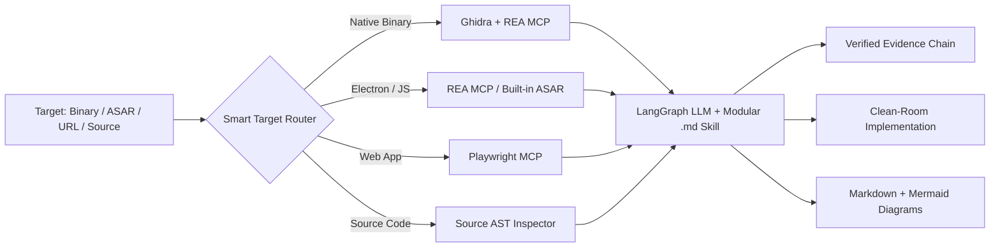

<div align="center">

# ⚡ DecompFlow

**自律型 AI リバースエンジニアリング・逆コンパイル・アーキテクチャ再構築スタジオ**  
*LangGraph • Model Context Protocol (MCP) • REA • Ghidra • Playwright*

[](../../LICENSE)
[](#クイックスタート)
[](#アーキテクチャ)
[](#)

</div>

<p align="center">
  <a href="../../README.md">English</a> •
  <a href="README.ru.md">Русский</a> •
  <a href="README.uk.md">Українська</a> •
  <a href="README.hi.md">हिन्दी</a> •
  <a href="README.zh-CN.md">简体中文</a> •
  <a href="README.es.md">Español</a> •
  <a href="README.de.md">Deutsch</a> •
  <a href="README.pt-BR.md">Português</a> •
  <a href="README.ja.md"><b>日本語</b></a>
</p>

---


## 📖 概要

DecompFlow は、LangGraph 状態マシンと Model Context Protocol (MCP) を基盤とし、Ghidra、REA、Playwright を連携させてソフトウェア解析を行うクロスプラットフォーム環境です。

### ✨ 主な機能

- **解析対象の自動判別 (`detectTargetType`):**
  - 🧬 **ネイティブバイナリ (`.exe`, `.elf`, `.dll`, `.so`, `.dylib`, `.apk`):** Ghidra MCP と REA による関数の逆コンパイル、相互参照 (xrefs) 解析、制御フローグラフの再構築。
  - 📦 **Electron & JS バンドル (`.asar`, 難読化ファイル):** REA MCP による IPC 通信チャネル (`ipcMain` / `ipcRenderer`) や preload ブリッジの抽出。
  - 🌐 **Web アプリケーション (`http://`, `https://`):** Playwright MCP による DOM 構造、フロントエンドスクリプト、非公開 REST/WebSocket API の抽出。
  - 📂 **ソースコードリポジトリ:** モジュール依存関係マップの生成、セキュリティ監査、オンボーディング資料の自動作成。
- **検証可能な証拠チェーンとクリーンルーム再実装:** すべての検出事項に検証可能な根拠（メモリアドレス、ファイルパス、通信チャネル）を付与し、綺麗な TypeScript/Python コードを出力。
- **デュアルインターフェース (CLI + Desktop Studio):** CI/CD 向けの高速 CLI と、React Flow ノードグラフや Mermaid 描画を備えたデスクトップ GUI。
- **OS との親和性 (Linux, Windows, macOS):** システムテーマ、アクセントカラー、プロキシ、OS 固有の設定保存先 (`XDG` / `AppData` / `Application Support`) に自動対応。

---

## 🏗️ アーキテクチャ



---

## 🚀 クイックスタート

```bash
# Клонирование и компиляция
git clone https://github.com/dropt1mx0/DecompFlow.git
cd DecompFlow
npm install
npm run build

# Запуск графического интерфейса Studio
npm run desktop

# Вызов анализа через терминал (CLI)
npm run dev -- analyze ./samples/sample_bin --mode binary --skill feature-reconstruct --prompt "buffer processing"
```

---

## 🧠 モジュール式スキル (skills/*.md)

| スキル (Skill) | 概要と用途 |
|---|---|
| **feature-reconstruct.md** | 特定の機能を追跡し、証拠テーブルを構築してクリーンルーム方式でコードを再構成。 |
| **binary-architecture.md** | 逆コンパイルされた C コードから上位モジュール、エントリポイント、呼び出しグラフを再構築。 |
| **security-audit.md** | メモリ安全性、ハードコードされた認証情報、安全でない IPC、OWASP リスクの検出。 |
| **web-api-mapper.md** | Web ターゲットから REST、GraphQL、WebSocket のスキーマと認証フローを抽出。 |
| **repo-onboarding.md** | 初見のコードベース向けにアーキテクチャ概要とデータフロー図を迅速に作成。 |
| **refactoring-doc.md** | 逆コンパイルコードの整形と、無名関数への意味論的な関数名の提案。 |

---

## 🖥️ クロスプラットフォーム配布パッケージ

```bash
# Linux (.AppImage, .deb, .rpm)
npm run dist:linux

# Windows (.exe NSIS & Portable)
npm run dist:win

# macOS (.dmg & .zip)
npm run dist:mac
```

---

## 📁 リポジトリ構成

```plaintext
DecompFlow/
├── config/                  # LLM settings (decompflow.yaml) & MCP registry (mcp-servers.json)
├── docs/i18n/               # Multilingual documentation
├── skills/                  # Modular Markdown skills for the AI agent
├── tools/                   # Local Ghidra JSON-RPC / MCP bridge
├── visual/                  # Exportable Dify DSL workflow template
└── packages/
    ├── core/                # @decompflow/core — LangGraph state machine & MCP client manager
    ├── cli/                 # decompflow — Terminal CLI interface
    └── desktop/             # @decompflow/desktop — Electron + React + Tailwind + React Flow Studio
```

---

## ⚖️ 免責事項 (Disclaimer)

DecompFlow は、正当な権限を持つセキュリティ監査、互換性研究、レガシーソフトウェアの保全、および教育目的でのみ使用されることを前提としています。ライセンス侵害や不正な悪用は固く禁止されています。

---

## 📄 ライセンス (MIT)

本ソフトウェアはオープンソースの MIT ライセンスの下で公開されています。詳細についてはリポジトリ内の LICENSE ファイルをご確認ください。
