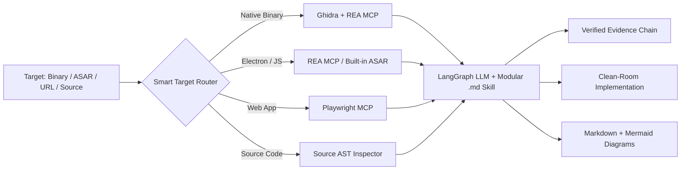

<div align="center">

# ⚡ DecompFlow

**Estúdio Autônomo com IA para Engenharia Reversa, Descompilação e Reconstrução**  
*LangGraph • Model Context Protocol (MCP) • REA • Ghidra • Playwright*

[](../../LICENSE)
[](#início-rápido)
[](#arquitetura)
[](#)

</div>

<p align="center">
  <a href="../../README.md">English</a> •
  <a href="README.ru.md">Русский</a> •
  <a href="README.uk.md">Українська</a> •
  <a href="README.hi.md">हिन्दी</a> •
  <a href="README.zh-CN.md">简体中文</a> •
  <a href="README.es.md">Español</a> •
  <a href="README.de.md">Deutsch</a> •
  <a href="README.pt-BR.md"><b>Português</b></a> •
  <a href="README.ja.md">日本語</a>
</p>

---


## 📖 Visão Geral

O DecompFlow é uma solução integrada de engenharia reversa que orquestra agentes via LangGraph e motores MCP (Model Context Protocol), reunindo Ghidra, REA e Playwright em uma única plataforma.

### ✨ Recursos Principais

- **Detecção Automática de Tipo de Alvo (`detectTargetType`):**
  - 🧬 **Binários Nativos (`.exe`, `.elf`, `.dll`, `.so`, `.dylib`, `.apk`):** Descompilação de rotinas, rastreamento de referências cruzadas (xrefs), extração de strings e reconstrução de fluxo com Ghidra MCP e REA.
  - 📦 **Electron e Bundles JS (`.asar`, pacotes minificados):** Inspeção de canais IPC (`ipcMain` / `ipcRenderer`), pontes de preload e dependências internas via REA MCP.
  - 🌐 **Aplicações Web (`http://`, `https://`):** Mapeamento de DOM, scripts do cliente e rotas REST/WebSocket com Playwright MCP.
  - 📂 **Repositórios de Código-Fonte:** Elaboração de grafos de módulos, análise de segurança e guias de integração arquitetural.
- **Cadeia de Evidências Verificáveis e Reconstrução em Sala Limpa:** Cada descoberta é documentada com dados rastreáveis e resulta em implementações limpas em TypeScript/Python.
- **Interface Dupla (CLI + Desktop Studio):** Automação em linha de comando para CI/CD ou interface de desktop rica com React Flow e Mermaid.
- **Integração Nativa com o Sistema Operacional:** Sincronização de tema e cores de destaque, proxy da rede e pastas nativas de configuração (`XDG` / `AppData` / `Application Support`).

---

## 🏗️ Arquitetura



---

## 🚀 Início Rápido

```bash
# Клонирование и компиляция
git clone https://github.com/dropt1mx0/DecompFlow.git
cd DecompFlow
npm install
npm run build

# Запуск графического интерфейса Studio
npm run desktop

# Вызов анализа через терминал (CLI)
npm run dev -- analyze ./samples/sample_bin --mode binary --skill feature-reconstruct --prompt "buffer processing"
```

---

## 🧠 Habilidades Modulares (skills/*.md)

| Habilidade (Skill) | Finalidade |
|---|---|
| **feature-reconstruct.md** | Localiza uma funcionalidade, monta a matriz de evidências e produz o código limpo correspondente. |
| **binary-architecture.md** | Reconstrói módulos de alto nível, rotas de entrada e diagramas de chamadas a partir de C descompilado. |
| **security-audit.md** | Analisa vulnerabilidades de memória, chaves embutidas, pontes IPC inseguras e falhas OWASP. |
| **web-api-mapper.md** | Mapeia contratos de dados REST/GraphQL/WebSocket e fluxos de autenticação web. |
| **repo-onboarding.md** | Gera visões arquiteturais concisas e diagramas de dados para bases de código desconhecidas. |
| **refactoring-doc.md** | Formata e comenta código descompilado, sugerindo nomes claros para funções internas. |

---

## 🖥️ Empacotamento Multiplataforma

```bash
# Linux (.AppImage, .deb, .rpm)
npm run dist:linux

# Windows (.exe NSIS & Portable)
npm run dist:win

# macOS (.dmg & .zip)
npm run dist:mac
```

---

## 📁 Estrutura do Monorepo

```plaintext
DecompFlow/
├── config/                  # LLM settings (decompflow.yaml) & MCP registry (mcp-servers.json)
├── docs/i18n/               # Multilingual documentation
├── skills/                  # Modular Markdown skills for the AI agent
├── tools/                   # Local Ghidra JSON-RPC / MCP bridge
├── visual/                  # Exportable Dify DSL workflow template
└── packages/
    ├── core/                # @decompflow/core — LangGraph state machine & MCP client manager
    ├── cli/                 # decompflow — Terminal CLI interface
    └── desktop/             # @decompflow/desktop — Electron + React + Tailwind + React Flow Studio
```

---

## ⚖️ Isenção de Responsabilidade (Disclaimer)

O DecompFlow destina-se estritamente à análise autorizada de segurança, pesquisa de compatibilidade de sistemas e preservação de software legítimo. O uso para violação de direitos autorais ou criação de software malicioso é terminantemente vedado.

---

## 📄 Licença (MIT)

O projeto é distribuído sob os termos da Licença MIT de código aberto. Consulte o documento LICENSE na raiz do repositório para maiores informações.
