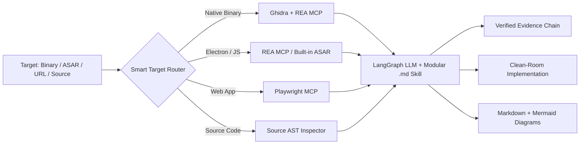

<div align="center">

# ⚡ DecompFlow

**Автономная AI-студия реверс-инжиниринга, декомпиляции и реконструкции архитектуры ПО**  
*LangGraph • Model Context Protocol (MCP) • REA • Ghidra • Playwright*

[](../../LICENSE)
[](#быстрый-старт)
[](#архитектура)
[](#)

</div>

<p align="center">
  <a href="../../README.md">English</a> •
  <a href="README.ru.md"><b>Русский</b></a> •
  <a href="README.uk.md">Українська</a> •
  <a href="README.hi.md">हिन्दी</a> •
  <a href="README.zh-CN.md">简体中文</a> •
  <a href="README.es.md">Español</a> •
  <a href="README.de.md">Deutsch</a> •
  <a href="README.pt-BR.md">Português</a> •
  <a href="README.ja.md">日本語</a>
</p>

---


## 📖 Обзор проекта

DecompFlow — это кроссплатформенная среда для автоматизированного анализа программного обеспечения, аудита бинарных файлов, исследования Electron/ASAR архивов и реверс-инжиниринга веб-интерфейсов на базе LangGraph и MCP.

### ✨ Ключевые возможности

- **Автоматическое определение формата цели (`detectTargetType`):**
  - 🧬 **Нативные бинарники (`.exe`, `.elf`, `.dll`, `.so`, `.dylib`, `.apk`):** декомпиляция функций, анализ перекрестных ссылок (xrefs), извлечение строк и реконструкция графа потока управления через Ghidra MCP и REA.
  - 📦 **Electron и JS-бандлы (`.asar`, минифицированные сборки):** извлечение IPC-каналов (`ipcMain` / `ipcRenderer`), анализ preload-мостов и структуры модулей с помощью REA MCP и встроенного инспектора.
  - 🌐 **Веб-приложения (`http://`, `https://`):** исследование DOM-дерева, скриптов клиента, скрытых REST и WebSocket API через Playwright MCP.
  - 📂 **Репозитории исходного кода:** генерация карты модулей, аудит уязвимостей и онбординг-документации.
- **Верифицированные доказательства и Clean-Room реконструкция:** каждая находка сопровождается проверяемыми фактами (адрес, файл, канал, достоверность) с генерацией чистого независимого кода на TypeScript/Python.
- **Два интерфейса (CLI + Desktop Studio):** автоматический запуск в CI/терминале или визуальная интерактивная работа с графами React Flow и диаграммами Mermaid.
- **Глубокая интеграция с ОС (Linux, Windows, macOS):** синхронизация с системной темой и цветом акцента, нативные пути конфигураций (`XDG` / `AppData` / `Application Support`) и платформенные хоткеи (`Ctrl` / `⌘`).

---

## 🏗️ Архитектура



---

## 🚀 Быстрый старт

```bash
# Клонирование и компиляция
git clone https://github.com/dropt1mx0/DecompFlow.git
cd DecompFlow
npm install
npm run build

# Запуск графического интерфейса Studio
npm run desktop

# Вызов анализа через терминал (CLI)
npm run dev -- analyze ./samples/sample_bin --mode binary --skill feature-reconstruct --prompt "buffer processing"
```

---

## 🧠 Модульные навыки (skills/*.md)

| Навык (Skill) | Назначение |
|---|---|
| **feature-reconstruct.md** | Поиск и изолированная реконструкция конкретной функции с формированием таблицы доказательств. |
| **binary-architecture.md** | Восстановление высокоуровневой архитектуры, точек входа и Mermaid-графов вызовов из декомпилированного C-кода. |
| **security-audit.md** | Анализ безопасности памяти, поиск хардкодных секретов, небезопасных IPC-мостов и рисков OWASP. |
| **web-api-mapper.md** | Построение схемы эндпоинтов REST/GraphQL/WebSocket и сценариев аутентификации веб-приложений. |
| **repo-onboarding.md** | Быстрое создание архитектурного обзора и схем потоков данных для незнакомых репозиториев. |
| **refactoring-doc.md** | Очистка декомпилированного/минифицированного кода и подбор семантических имен для неименованных функций. |

---

## 🖥️ Кроссплатформенная сборка

```bash
# Linux (.AppImage, .deb, .rpm)
npm run dist:linux

# Windows (.exe NSIS & Portable)
npm run dist:win

# macOS (.dmg & .zip)
npm run dist:mac
```

---

## 📁 Структура монорепозитория

```plaintext
DecompFlow/
├── config/                  # LLM settings (decompflow.yaml) & MCP registry (mcp-servers.json)
├── docs/i18n/               # Multilingual documentation
├── skills/                  # Modular Markdown skills for the AI agent
├── tools/                   # Local Ghidra JSON-RPC / MCP bridge
├── visual/                  # Exportable Dify DSL workflow template
└── packages/
    ├── core/                # @decompflow/core — LangGraph state machine & MCP client manager
    ├── cli/                 # decompflow — Terminal CLI interface
    └── desktop/             # @decompflow/desktop — Electron + React + Tailwind + React Flow Studio
```

---

## ⚖️ Отказ от ответственности (Disclaimer)

DecompFlow разработан исключительно для санкционированного аудита безопасности, исследований совместимости, ретро-анализа и образовательных целей на программном обеспечении, к которому у вас есть законный доступ. Любое несанкционированное использование для обхода защит или создания вредоносного ПО строго запрещено.

---

## 📄 Лицензия (MIT)

Проект DecompFlow распространяется на условиях свободной и открытой лицензии MIT. Подробный текст лицензии и условия авторского права находятся в файле LICENSE в корне репозитория.
