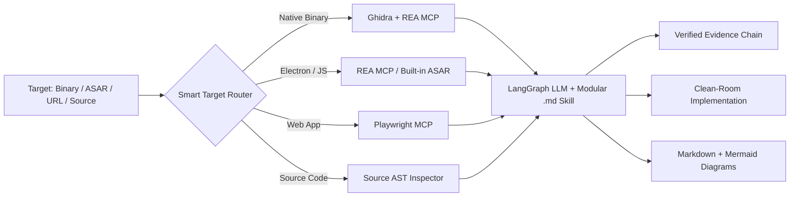

<div align="center">

# ⚡ DecompFlow

**Автономна AI-студія реверс-інжинірингу, декомпіляції та реконструкції архітектури ПЗ**  
*LangGraph • Model Context Protocol (MCP) • REA • Ghidra • Playwright*

[](../../LICENSE)
[](#швидкий-старт)
[](#архітектура)
[](#)

</div>

<p align="center">
  <a href="../../README.md">English</a> •
  <a href="README.ru.md">Русский</a> •
  <a href="README.uk.md"><b>Українська</b></a> •
  <a href="README.hi.md">हिन्दी</a> •
  <a href="README.zh-CN.md">简体中文</a> •
  <a href="README.es.md">Español</a> •
  <a href="README.de.md">Deutsch</a> •
  <a href="README.pt-BR.md">Português</a> •
  <a href="README.ja.md">日本語</a>
</p>

---


## 📖 Огляд проєкту

DecompFlow — це сучасний кросплатформний інструментарій для автоматизованого реверс-інжинірингу, аналізу бінарних файлів, пакунків Electron/ASAR та дослідження веб-інтерфейсів на базі LangGraph і MCP.

### ✨ Ключові можливості

- **Автоматичне визначення типу цілі (`detectTargetType`):**
  - 🧬 **Нативні бінарні файли (`.exe`, `.elf`, `.dll`, `.so`, `.dylib`, `.apk`):** декомпіляція функцій, аналіз перехресних посилань (xrefs), вилучення рядків та побудова графа викликів за допомогою Ghidra MCP та REA.
  - 📦 **Electron та JS-пакунки (`.asar`, мініфіковані бандли):** аналіз IPC-каналів (`ipcMain` / `ipcRenderer`), preload-мостів та модулів через REA MCP і резервний офлайн-інспектор.
  - 🌐 **Веб-додатки (`http://`, `https://`):** сканування структури DOM, клієнтських скриптів, прихованих ендпоінтів REST і WebSocket через Playwright MCP.
  - 📂 **Репозиторії вихідного коду:** складання карт залежностей модулів, безпековий аудит та онбординг-документація.
- **Верифіковані докази та реконструкція Clean-Room:** кожен висновок фіксується у ланцюгу доказів (адреса, файл, канал, ступінь достовірності) з генерацією готової реалізації на TypeScript/Python.
- **Подвійний інтерфейс (CLI + Desktop Studio):** автоматизований запуск через CLI для терміналу/CI або візуальний Desktop GUI з інтерактивними графами React Flow і діаграмами Mermaid.
- **Глибока інтеграція з ОС (Linux, Windows, macOS):** автоматична підтримка системної теми, кольору акценту, нативних шляхів налаштувань (`XDG` / `AppData` / `Application Support`) та гарячих клавіш (`Ctrl` / `⌘`).

---

## 🏗️ Архітектура



---

## 🚀 Швидкий старт

```bash
# Клонирование и компиляция
git clone https://github.com/dropt1mx0/DecompFlow.git
cd DecompFlow
npm install
npm run build

# Запуск графического интерфейса Studio
npm run desktop

# Вызов анализа через терминал (CLI)
npm run dev -- analyze ./samples/sample_bin --mode binary --skill feature-reconstruct --prompt "buffer processing"
```

---

## 🧠 Модульні навички (skills/*.md)

| Навичка (Skill) | Призначення |
|---|---|
| **feature-reconstruct.md** | Пошук цільової функції у бінарнику/бандлі, збирання ланцюга доказів та чиста реконструкція коду. |
| **binary-architecture.md** | Відновлення високорівневої структури модулів, точок входу та Mermaid-графів викликів. |
| **security-audit.md** | Пошук вразливостей пам'яті, захардкодscriptжених ключів, небезпечних IPC-мостів та ризиків OWASP. |
| **web-api-mapper.md** | Дослідження схем REST/GraphQL/WebSocket та сценаріїв автентифікації веб-сервісів. |
| **repo-onboarding.md** | Створення архітектурного огляду та схем потоків даних для нових кодових баз. |
| **refactoring-doc.md** | Очищення та коментування декомпілованого коду, призначення людиночитаних імен функціям. |

---

## 🖥️ Кросплатформна збірка

```bash
# Linux (.AppImage, .deb, .rpm)
npm run dist:linux

# Windows (.exe NSIS & Portable)
npm run dist:win

# macOS (.dmg & .zip)
npm run dist:mac
```

---

## 📁 Структура монорепозиторію

```plaintext
DecompFlow/
├── config/                  # LLM settings (decompflow.yaml) & MCP registry (mcp-servers.json)
├── docs/i18n/               # Multilingual documentation
├── skills/                  # Modular Markdown skills for the AI agent
├── tools/                   # Local Ghidra JSON-RPC / MCP bridge
├── visual/                  # Exportable Dify DSL workflow template
└── packages/
    ├── core/                # @decompflow/core — LangGraph state machine & MCP client manager
    ├── cli/                 # decompflow — Terminal CLI interface
    └── desktop/             # @decompflow/desktop — Electron + React + Tailwind + React Flow Studio
```
