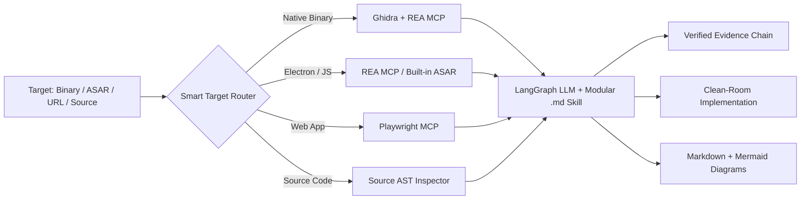

<div align="center">

# ⚡ DecompFlow

**自主式 AI 逆向工程、二进制反编译与软件架构重构工作台**  
*LangGraph • Model Context Protocol (MCP) • REA • Ghidra • Playwright*

[](../../LICENSE)
[](#快速上手)
[](#架构设计)
[](#)

</div>

<p align="center">
  <a href="../../README.md">English</a> •
  <a href="README.ru.md">Русский</a> •
  <a href="README.uk.md">Українська</a> •
  <a href="README.hi.md">हिन्दी</a> •
  <a href="README.zh-CN.md"><b>简体中文</b></a> •
  <a href="README.es.md">Español</a> •
  <a href="README.de.md">Deutsch</a> •
  <a href="README.pt-BR.md">Português</a> •
  <a href="README.ja.md">日本語</a>
</p>

---


## 📖 项目概述

DecompFlow 是基于 LangGraph 状态机与 MCP 开放协议构建的下一代逆向工程平台，有机整合了 Ghidra、REA 与 Playwright，实现高精度自动化代码还原与安全审计。

### ✨ 核心特性

- **多目标类型自动探测 (`detectTargetType`):**
  - 🧬 **原生二进制程序 (`.exe`, `.elf`, `.dll`, `.so`, `.dylib`, `.apk`):** 利用 Ghidra MCP 和 REA 反编译函数，追踪交叉引用 (xrefs)，提取字符串并重建调用图。
  - 📦 **Electron 与 JS 代码包 (`.asar`, 混淆压缩包):** 依靠 REA MCP 及离线检查器提取 IPC 通信通道 (`ipcMain` / `ipcRenderer`)、preload 桥接与模块拓扑。
  - 🌐 **Web 应用程序 (`http://`, `https://`):** 借助 Playwright MCP 解析前端 DOM 结构、客户端脚本以及隐藏的 REST / WebSocket 接口。
  - 📂 **源代码工程目录:** 梳理模块依赖图谱、安全缺陷审查与新员工入职架构指引。
- **可验证证据链与净室重构 (Clean-Room):** 每一处推论均包含定位锚点（文件路径、内存地址、IPC 信道及置信评分），并自动生成全新规范的 TypeScript/Python 实现。
- **双工作模式 (CLI + Desktop Studio):** 支持 CI/CD 自动化的无头命令行接口与基于 React Flow 和 Mermaid 图表的交互式桌面客户端。
- **深层操作系统融合 (Linux, Windows, macOS):** 自适应系统深浅色与主题色，直通系统代理，适配原生路径 (`XDG` / `AppData` / `Application Support`) 及平台快捷键。

---

## 🏗️ 架构设计



---

## 🚀 快速上手

```bash
# Клонирование и компиляция
git clone https://github.com/dropt1mx0/DecompFlow.git
cd DecompFlow
npm install
npm run build

# Запуск графического интерфейса Studio
npm run desktop

# Вызов анализа через терминал (CLI)
npm run dev -- analyze ./samples/sample_bin --mode binary --skill feature-reconstruct --prompt "buffer processing"
```

---

## 🧠 模块化技能 (skills/*.md)

| 技能模块 (Skill) | 作用与场景 |
|---|---|
| **feature-reconstruct.md** | 定位目标功能并梳理证据链表格，完成净室代码重写与逻辑复现。 |
| **binary-architecture.md** | 从反编译 C 代码提炼顶层模块结构、程序入口及 Mermaid 调用流向图。 |
| **security-audit.md** | 扫描内存安全缺陷、硬编码凭据、不安全 IPC 通信及 OWASP Top 10 漏洞。 |
| **web-api-mapper.md** | 嗅探解析目标站点的 REST/GraphQL/WebSocket 数据协议及身份校验流程。 |
| **repo-onboarding.md** | 为大型未知代码工程快速生成架构透视图与数据流向脉络。 |
| **refactoring-doc.md** | 整理优化混淆或反编译符号，为匿名函数推导高语义名称。 |

---

## 🖥️ 跨平台打包构建

```bash
# Linux (.AppImage, .deb, .rpm)
npm run dist:linux

# Windows (.exe NSIS & Portable)
npm run dist:win

# macOS (.dmg & .zip)
npm run dist:mac
```

---

## 📁 代码仓库拓扑

```plaintext
DecompFlow/
├── config/                  # LLM settings (decompflow.yaml) & MCP registry (mcp-servers.json)
├── docs/i18n/               # Multilingual documentation
├── skills/                  # Modular Markdown skills for the AI agent
├── tools/                   # Local Ghidra JSON-RPC / MCP bridge
├── visual/                  # Exportable Dify DSL workflow template
└── packages/
    ├── core/                # @decompflow/core — LangGraph state machine & MCP client manager
    ├── cli/                 # decompflow — Terminal CLI interface
    └── desktop/             # @decompflow/desktop — Electron + React + Tailwind + React Flow Studio
```

---

## ⚖️ 免责声明 (Disclaimer)

DecompFlow 仅可用于经正规授权的安全防御审查、系统兼容性测试、古老软件保护与正当教学科研用途。严禁用于破解非授权软件、破坏知识产权或开发恶意攻击载荷。

---

## 📄 开源许可协议 (MIT License)

本项目遵循开放友好的 MIT 开源许可证。完整条款与权利归属声明请见根目录下的 LICENSE 文本文件。
