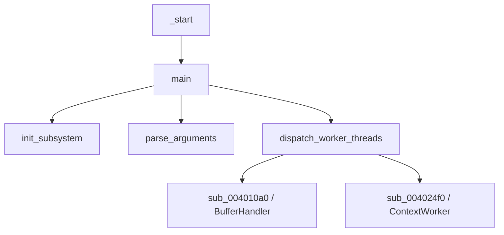

# DecompFlow Analysis Report

**Target:** `./samples/sample_bin`  
**Mode:** `binary`  
**Active Skill:** `binary-architecture`  
**Timestamp:** `2026-11-23T14:40:41.045Z`  

---

## Executive Summary

Architectural reconstruction for binary target ./samples/sample_bin using binary-architecture. The binary exposes standard entrypoints, initializes worker threads, and encapsulates command routing.

## Architecture Diagram

## Key Findings

- Primary entrypoint `_start` delegates to `main` with standard argument vectors
- Subsystem initialization sequence verified prior to thread dispatching
- Function `sub_004010a0` handles input buffer processing and memory boundary validation
- Function `sub_004024f0` manages persistent context state and teardown routines
- String table cross-references indicate network configuration and logging paths

## Recommendations

- Standardize error return codes across worker threads in `sub_004024f0`
- Enforce strict length validation bounds in `sub_004010a0` input buffers
- Consider refactoring anonymous subroutine symbols to reflect domain roles (e.g., `BufferHandler`)

---
*Generated by DecompFlow — Autonomous AI Architecture & Reverse Engineering Agent*