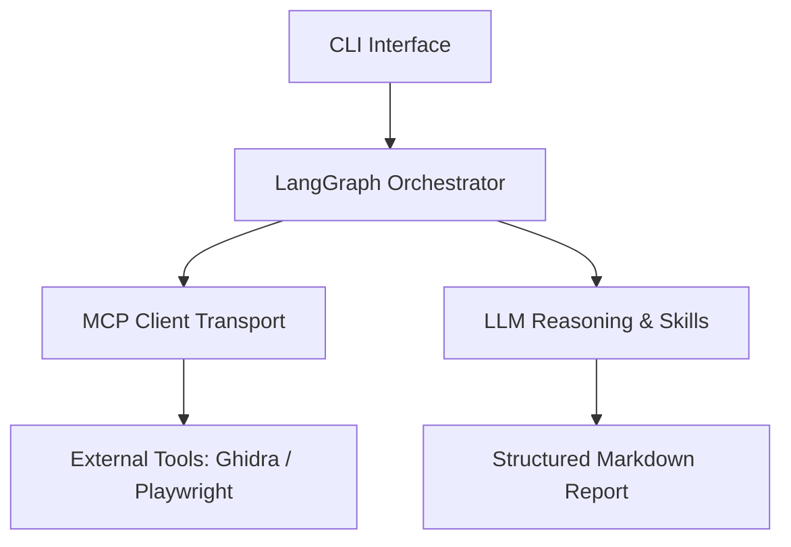

# DecompFlow Analysis Report

**Target:** `./src`  
**Mode:** `source`  
**Active Skill:** `code-cleanup`  
**Timestamp:** `2026-11-23T12:31:13.873Z`  

---

## Executive Summary

Source repository architectural overview for ./src under code-cleanup. High-level component decomposition demonstrates clean separation of concerns.

## Architecture Diagram

## Key Findings

- Modular state machine implementation via LangGraph Annotation
- Loose coupling between MCP tool consumers and external tool transports
- Declarative rule ingestion driven by modular Markdown skills

## Recommendations

- Maintain strict schemas for all state transitions across pipeline nodes
- Add automated CI testing for MCP transport reconnection semantics

---
*Generated by DecompFlow — Autonomous AI Architecture & Reverse Engineering Agent*