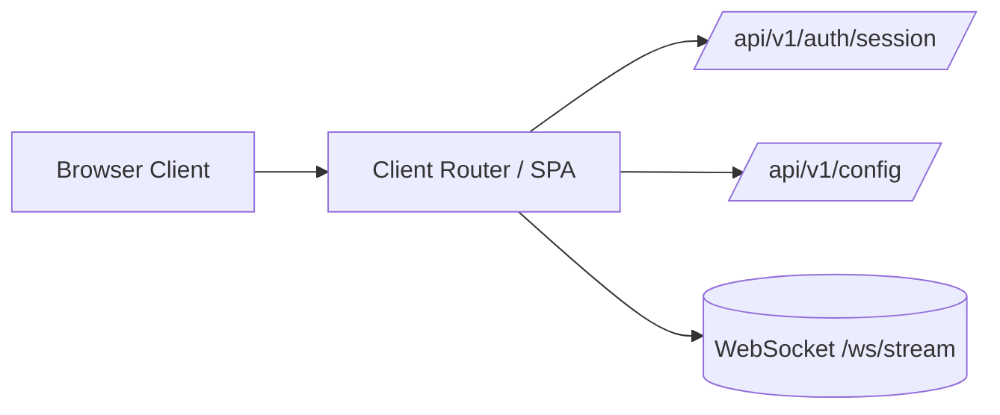

# DecompFlow Analysis Report

**Target:** `https://example.com`  
**Mode:** `web`  
**Active Skill:** `security-audit`  
**Timestamp:** `2026-11-23T12:32:21.280Z`  

---

## Executive Summary

Web application inspection for https://example.com using security-audit. Discovered single-page application structure with modular client-side routing and REST/WebSocket API endpoints.

## Architecture Diagram

## Key Findings

- SPA client architecture dynamically loads modular scripts from `/assets/`
- Authenticated sessions are coordinated via `/api/v1/auth/session`
- Real-time event synchronization handled through persistent `/ws/stream` WebSocket connection
- Identified declarative client routing patterns with strict CORS origin separation

## Recommendations

- Ensure WebSocket handshake enforces strict origin validation and token expiry
- Consolidate client bundle splitting to minimize initial DOM render latency
- Implement Content Security Policy (CSP) headers restricting script execution sources

---
*Generated by DecompFlow — Autonomous AI Architecture & Reverse Engineering Agent*